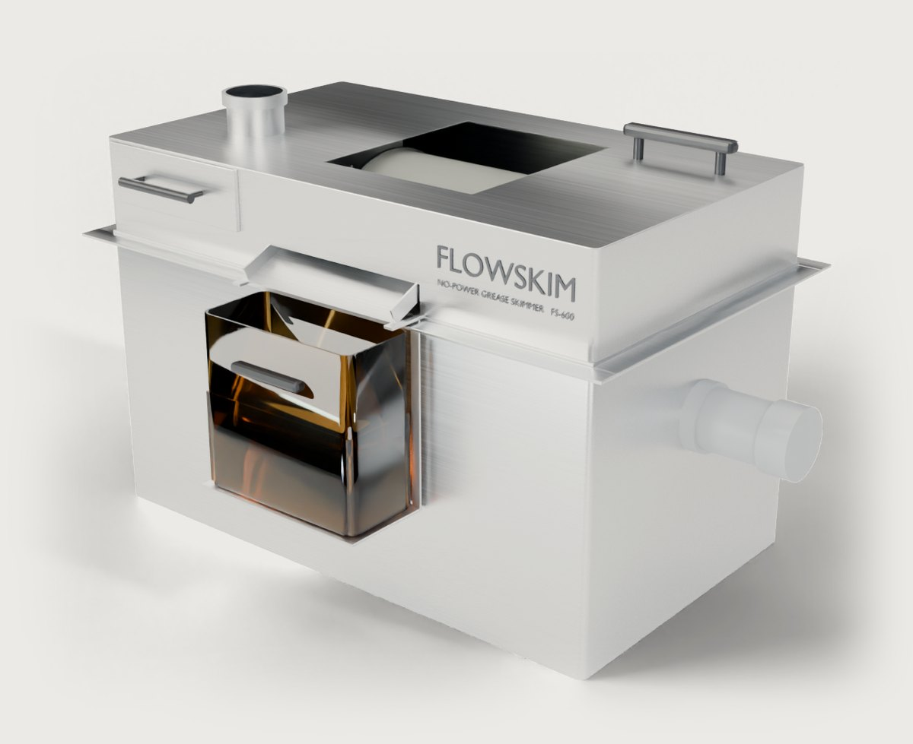
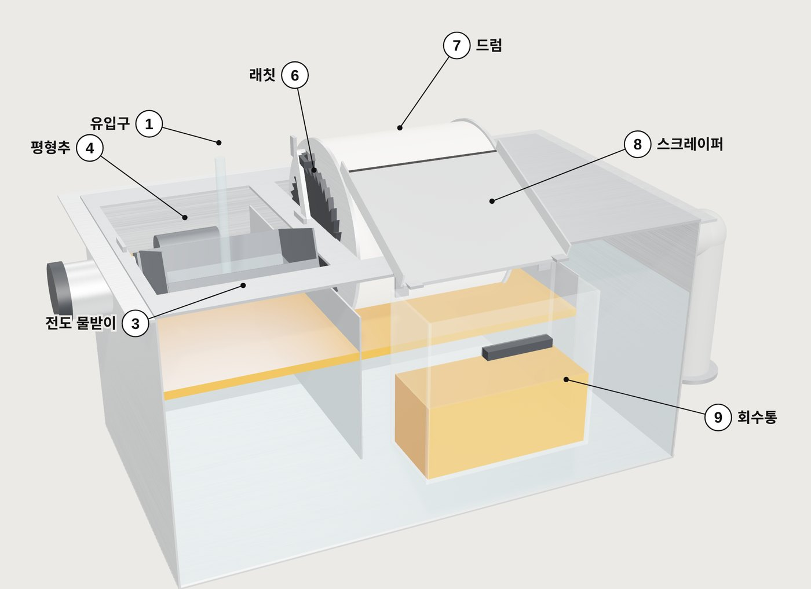
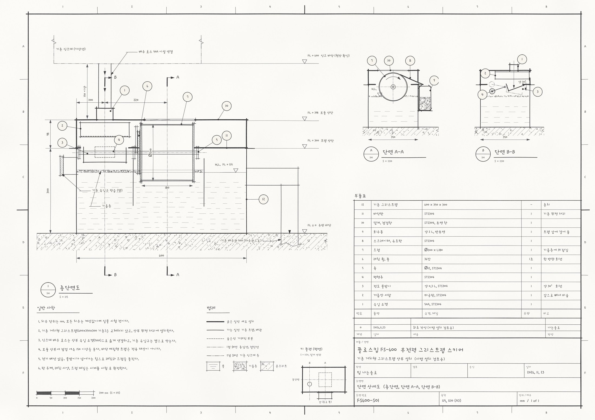
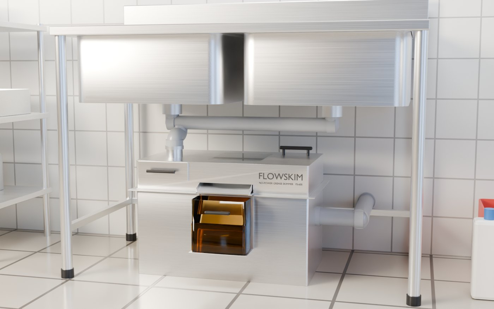
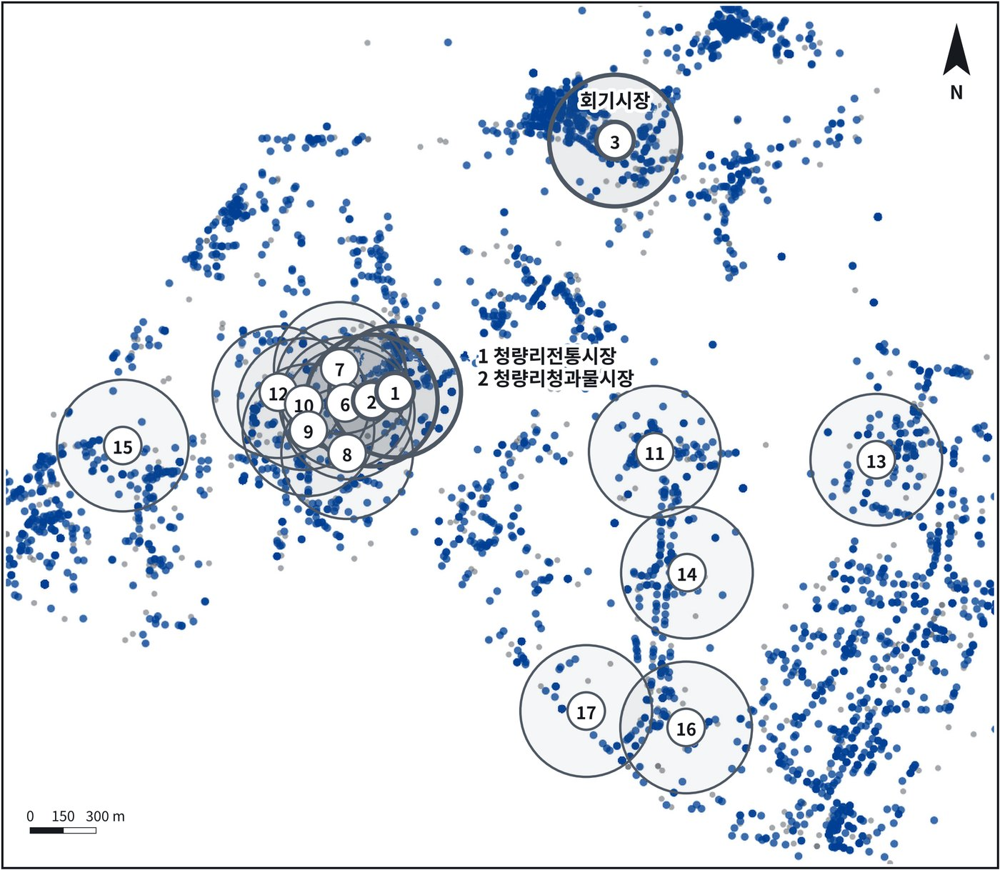
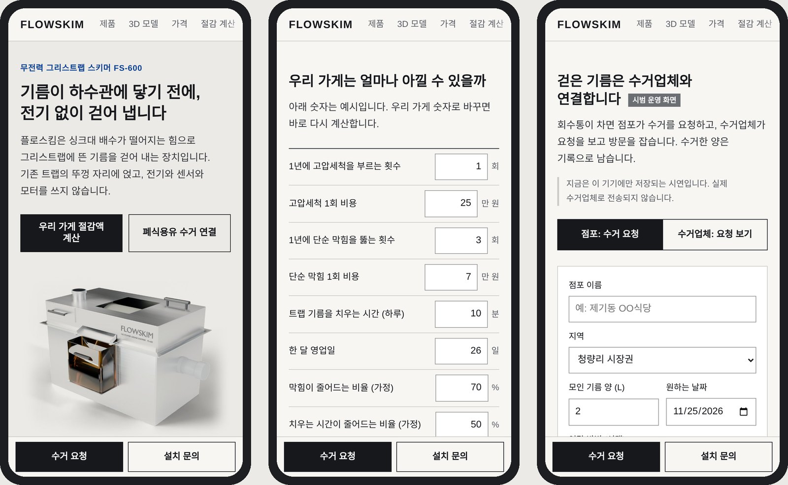

# 플로스킴 (FlowSkim) — 배수의 힘으로 도는 무전력 그리스트랩 스키머

**2026 글로컬 미래도시 혁신 프로그램** · 서울시립대학교 · 팀 나는욜로

싱크대 배수가 떨어지는 힘으로 그리스트랩에 뜬 기름을 걷어 내는 장치입니다.
기존 트랩 위에 얹고, 전기·센서·모터를 쓰지 않습니다.

- **소개 페이지**: https://dubaijjondeukbai.github.io/ploskim/
- **발표자료**: [docs/pitch-deck.pdf](docs/pitch-deck.pdf)
- **단면 상세도**: [docs/FS600-S01-section-detail.pdf](docs/FS600-S01-section-detail.pdf)
- **조립도**: [docs/FS600-A01-assembly.pdf](docs/FS600-A01-assembly.pdf)
- **3D 모델**: [model/flowskim-fs600.glb](model/flowskim-fs600.glb)



## 문제

음식점에서 싱크대로 내려간 기름은 그리스트랩에 뜹니다. 사람이 직접 퍼내야 해서 바쁘면 방치되고,
트랩을 넘어간 기름은 하수관 안에서 굳어 관을 막습니다.

| 숫자 | 내용 |
|---|---|
| 732억 원 | 서울시 2026년 하수관 준설과 빗물받이 청소 예산 |
| 55% | 동대문구 하수관 가운데 30년을 넘긴 관 |
| 25만 원~ | 고압세척 한 번 (단순 막힘도 5만~9만 원) |
| 47% | 하수관 막힘 가운데 기름이 원인 (미국 환경보호청) |

출처(발표자료 표기): 서울시 발표 자료, 동대문구의회 회의록, 하수구 청소 업체 이용 후기와 가격 안내(검색 결과 기준), 미국 환경보호청

## 작동 원리

1. **물이 고입니다.** 싱크대 배수가 위쪽 유입구로 들어와 전도 물받이에 모입니다.
2. **넘어가며 드럼을 돌립니다.** 물 무게로 물받이가 넘어갈 때마다 래칫이 드럼을 한 칸씩 돌립니다.
3. **기름을 긁어 모읍니다.** 드럼에 묻어 올라온 기름을 스크레이퍼가 긁어 앞쪽 회수통으로 보냅니다.





## 사양 (FS-600)

| 항목 | 값 |
|---|---|
| 크기 | 600 × 350 mm, 트랩 위로 98 mm |
| 구동 | 전도 물받이, 래칫 36칸, 드럼 Ø200 × 180 mm를 한 축에 |
| 회수통 | 약 2 L, 반투명. 앞에서 빼서 비움 |
| 전기 | 0 W (센서 0개, 모터 0개) |
| 설치 조건 | 싱크대 아래 거치형 트랩, 위쪽 여유 약 15 cm. 배수 호스를 위쪽 유입구로 옮김 |
| 지원하지 않음 | 바닥에 묻힌 트랩 |

치수와 성능은 계산값이며 실물 시험 전입니다.

## 사업 모델

- **구독 월 39,000원(목표가), 설치비 0원**: 장치 대여와 설치, 월 1회 방문 점검, 소모품(스크레이퍼 날) 교체, 폐식용유 수거업체 연결
- 시범 설치 3개월 뒤 유료로 전환하는 방식으로 시작합니다.
- 장치 18만 원(재료와 가공)과 설치 5만 원이 듭니다. 방문 관리와 소모품을 빼면 점포 한 곳에서 한 달에 2.4만 원(구독료의 62%)이 남아 약 9.6개월에 회수합니다.
- 손익분기는 125곳입니다(월 고정비 300만 원 가정).
- 재료비는 STS304 판재 소매가 기준이고, 가공비·부품비·방문비·고정비는 견적 전 가정입니다.



## 시작 지역

상가정보와 전통시장 데이터를 묶어, 동대문구 전통시장 반경 300 m 안에 조사 후보 점포가 많은 곳부터 찾아갑니다(2026년 11월 22일 계산).

| 순위 | 시장 | 반경 300 m 안 조사 후보 점포 |
|---|---|---|
| 1 | 청량리전통시장 | 270곳 |
| 2 | 청량리청과물시장 | 255곳 |
| 3 | 회기시장 | 253곳 |

조사 후보는 업종으로 고른 것이라, 실제로 얹을 수 있는 트랩인지는 방문해서 확인해야 합니다.



넓혀 가는 순서: 동대문구 → 서울 전통시장 → 국내 가맹점과 싱가포르

## 현재 단계

- 만든 것: 3D 모델, 조립도(FS600-A01), 단면 상세도(FS600-S01), 소개 페이지(절감 계산기, 폐식용유 수거 연결 시범 화면)
- 다음 일: 실물 시제품 제작과 시험, 시범 설치 10곳(3개월), 출원과 판매 전 변리사 선행조사
- 선행특허 9건은 웹 검색으로 찾아 본문을 확인했습니다(발표자료 부록). 법적 판단은 아닙니다.

## 소개 페이지



제품 소개, 3D 모델, 가격, 우리 가게 절감액 계산, 폐식용유 수거 연결(시범 화면)을 한 페이지에 담았습니다.
PC와 휴대폰에서 모두 열리고, `index.html` 파일 하나로 동작합니다.
GitHub Pages에서 수거 요청은 보는 사람의 기기에만 저장되는 시연이며, 실제 수거업체로 전송되지 않습니다.

## 저장소 구성

```
ploskim/
├── index.html              소개 페이지 (GitHub Pages 첫 화면)
├── README.md
├── docs/
│   ├── pitch-deck.pdf                  발표자료
│   ├── FS600-S01-section-detail.pdf    단면 상세도 (A3)
│   └── FS600-A01-assembly.pdf          조립도 (A3)
├── images/                 README 그림
├── model/
│   └── flowskim-fs600.glb  3D 모델 (glTF)
└── src/web/                소개 페이지 소스 (HTML, CSS, JS, 3D 뷰어)
```

## 소개 페이지 다시 만들기 (선택)

Node.js와 Python 3가 필요합니다.

```bash
cd src/web
npm install
npm run build      # 3D 뷰어를 묶고, 저장소 맨 위의 index.html을 다시 씀
```

## 팀

나는욜로 (서울시립대학교). 문의는 소개 페이지 맨 아래 연락처로 부탁드립니다.

---

가격, 절감액, 성능에는 목표값과 계산값이 들어 있으며 실물 시험 결과가 아닙니다.
